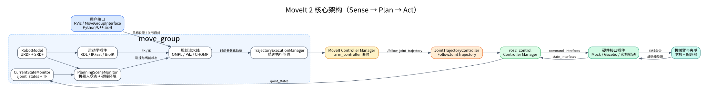
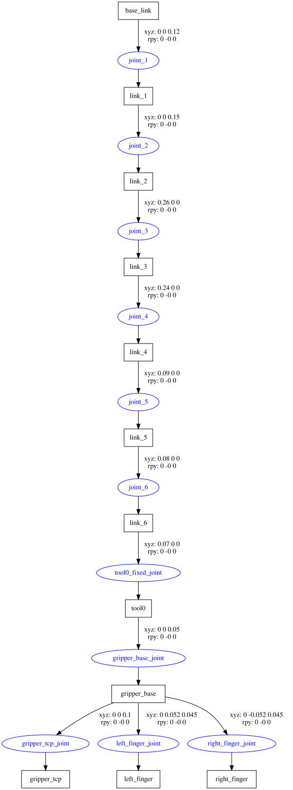
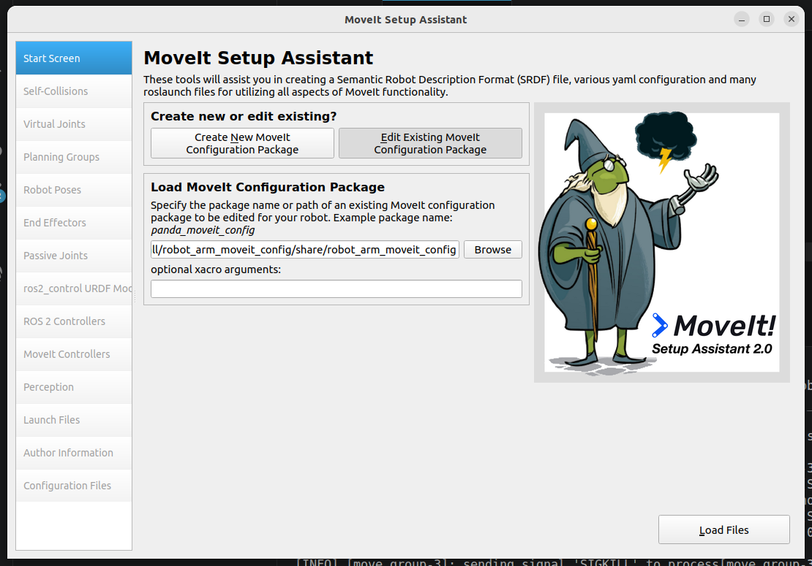
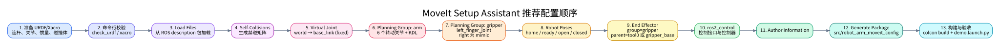
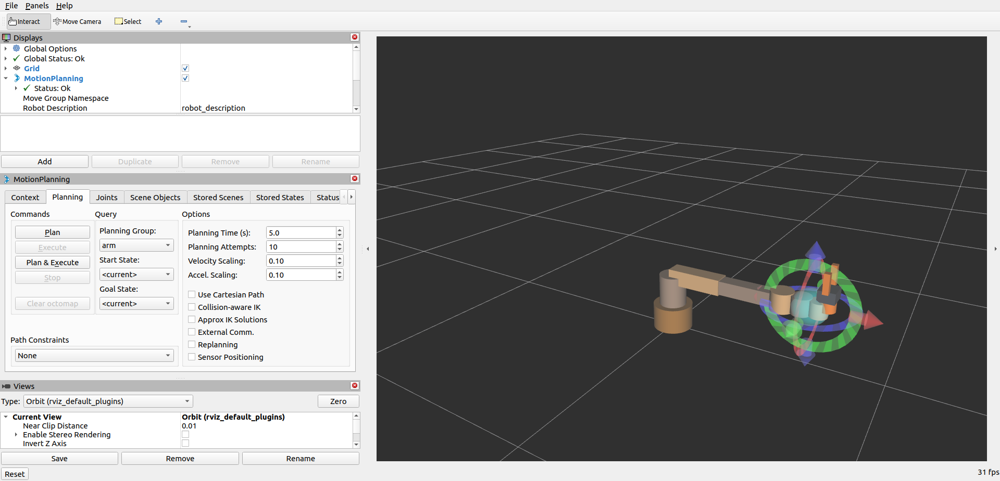
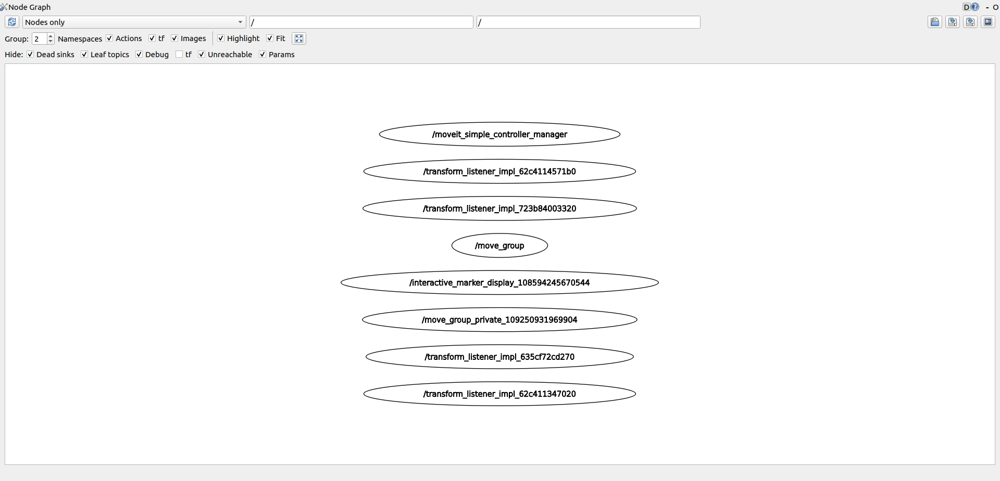
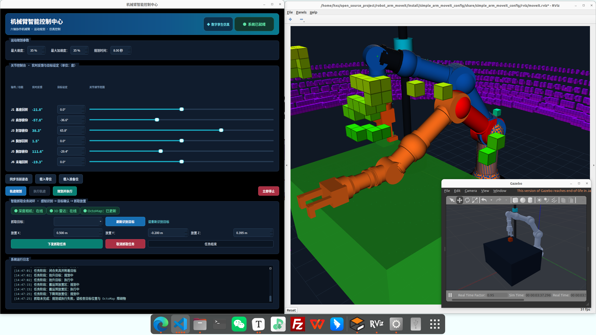
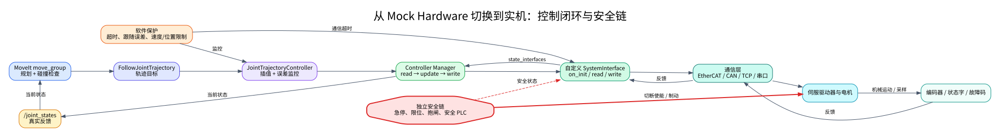

# MoveIt 2 从入门到实机：六轴机械臂与夹爪实践教程

> 适用环境：Ubuntu 22.04、ROS 2 Humble、MoveIt 2.5.x、ros2_control 2.x  
> 配套工程：`robot_arm_moveit`  
> 配套模型：`generic_6dof_arm_with_gripper`  
> 文档版本：2026-11-06

这不是一份只介绍按钮位置的说明书，而是一条完整的学习路线：先理解 MoveIt 2 在机器人系统中的位置，再创建并校验 URDF，使用 Setup Assistant 配置机械臂和夹爪，运行 RViz Demo，最后把 Mock Hardware 替换成真实机械臂驱动。

---

## 目录

1. [先建立整体认识](#1-先建立整体认识)
2. [准备环境与工作区](#2-准备环境与工作区)
3. [创建可用于 MoveIt 的 URDF](#3-创建可用于-moveit-的-urdf)
4. [使用 Setup Assistant 生成配置](#4-使用-setup-assistant-生成配置)
5. [补全 ros2_control 与夹爪控制](#5-补全-ros2_control-与夹爪控制)
6. [运行 Demo 并完成第一次规划](#6-运行-demo-并完成第一次规划)
7. [用 C++ 调用 MoveIt](#7-用-c-调用-moveit)
8. [规划场景、抓取与感知](#8-规划场景抓取与感知)
9. [从 Mock Hardware 切换到实机](#9-从-mock-hardware-切换到实机)
10. [常见故障与定位方法](#10-常见故障与定位方法)
11. [推荐练习路线](#11-推荐练习路线)
12. [术语与参考资料](#12-术语与参考资料)

建议按下面的节奏学习：

| 阶段 | 建议用时 | 完成标志 |
|---|---:|---|
| 框架与 URDF | 0.5～1 天 | 能解释 URDF、SRDF、`move_group`、ros2_control 的关系 |
| Setup Assistant | 0.5 天 | 能独立生成并读懂 `*_moveit_config` |
| RViz 与编程 | 1～2 天 | 能规划、执行、添加障碍物 |
| 夹爪与抓取 | 1～2 天 | 能控制平行夹爪并完成 attach/detach |
| 实机联动 | 视驱动而定 | 编码器反馈、轨迹执行和急停链路全部通过验收 |

---

## 1. 先建立整体认识

### 1.1 MoveIt 2 到底负责什么

一句话概括：

> MoveIt 2 负责“机器人应该怎样运动”，ros2_control 和硬件驱动负责“电机怎样真正动起来”。

MoveIt 2 的核心工作包括：

- 维护机器人当前状态；
- 维护机器人与环境的碰撞模型；
- 进行正运动学、逆运动学和碰撞检测；
- 根据目标位姿或目标关节角规划路径；
- 给路径增加速度、加速度和时间信息；
- 把最终轨迹交给控制器执行。

MoveIt 2 **不是**伺服驱动器，也不会直接发送 CAN、EtherCAT 或串口报文。它通常把 `trajectory_msgs/JointTrajectory` 包装在 `FollowJointTrajectory` Action 中，交给 ros2_control 控制器。



图中的主数据流可以读成：

```text
目标位姿
  → move_group
  → IK + PlanningScene + Planner
  → 带时间的关节轨迹
  → MoveIt Controller Manager
  → JointTrajectoryController
  → ros2_control HardwareInterface
  → 电机

编码器
  → HardwareInterface
  → /joint_states
  → MoveIt CurrentStateMonitor
```

### 1.2 最重要的组件

| 组件 | 通俗解释 | 本工程中的位置 |
|---|---|---|
| URDF/Xacro | 机器人的“骨架、外形、质量说明书” | `robot_arm_description/urdf` |
| SRDF | MoveIt 的“语义说明书” | `robot_arm_moveit_config/config/*.srdf` |
| RobotModel | URDF + SRDF 解析后的只读模型 | MoveIt 内部 |
| RobotState | 某一时刻所有关节值和连杆位姿 | MoveIt 内部 |
| PlanningScene | RobotState + 障碍物 + Allowed Collision Matrix | `move_group` 内部 |
| PlanningSceneMonitor | 持续同步关节、TF、碰撞物、OctoMap | `move_group` 内部 |
| Kinematics Plugin | FK/IK 求解器，如 KDL、IKFast | `kinematics.yaml` |
| Planning Pipeline | OMPL、Pilz、CHOMP 等规划器与适配器 | `ompl_planning.yaml` 等 |
| TrajectoryExecutionManager | 选择控制器并监督轨迹执行 | `move_group` 内部 |
| Controller Manager | 加载和管理 ros2_control 控制器 | `ros2_control_node` |
| HardwareInterface | Mock、仿真或真实硬件的统一抽象 | URDF 的 `<ros2_control>` |

官方的 [MoveIt Concepts](https://moveit.picknik.ai/humble/doc/concepts/concepts.html)、[Motion Planning](https://moveit.picknik.ai/humble/doc/concepts/motion_planning.html) 和 [move_group](https://moveit.picknik.ai/humble/doc/concepts/move_group.html) 页面适合在完成本章后继续阅读。

### 1.3 URDF 与 SRDF 的区别

URDF 描述“物理上有什么”：

- link 和 joint；
- visual 和 collision；
- 惯量、质量；
- 关节上下限；
- mimic 关系；
- ros2_control 接口。

SRDF 描述“MoveIt 应该怎样理解它”：

- 规划组；
- 虚拟关节；
- 命名姿态；
- 末端执行器；
- 被动关节；
- 可以忽略的自碰撞对。

两者缺一不可。官方说明见 [URDF and SRDF](https://moveit.picknik.ai/humble/doc/examples/urdf_srdf/urdf_srdf_tutorial.html)。

---

## 2. 准备环境与工作区

### 2.1 安装核心软件

```bash
sudo apt update
sudo apt install \
  ros-humble-moveit \
  ros-humble-moveit-setup-assistant \
  ros-humble-ros2-control \
  ros-humble-ros2-controllers \
  ros-humble-xacro \
  ros-humble-robot-state-publisher \
  ros-humble-joint-state-publisher-gui
```

进入当前工程：

```bash
cd ~/open_source_project/robot_arm_moveit
source /opt/ros/humble/setup.bash
rosdep install --from-paths src --ignore-src -r -y
colcon build --symlink-install
source install/setup.bash
```

每开一个新终端，都要重新执行：

```bash
source /opt/ros/humble/setup.bash
source ~/open_source_project/robot_arm_moveit/install/setup.bash
```

“构建了但没 source”是 ROS 2 最常见的问题之一。

### 2.2 本教程使用的两个包

```text
src/
├── robot_arm_description/
│   ├── CMakeLists.txt
│   ├── package.xml
│   ├── launch/
│   │   └── setup_assistant.launch.py
│   └── urdf/
│       └── generic_6dof_arm_with_gripper.urdf
└── robot_arm_moveit_config/
    ├── .setup_assistant
    ├── config/
    │   ├── generic_6dof_arm_with_gripper.srdf
    │   ├── generic_6dof_arm_with_gripper.urdf.xacro
    │   ├── generic_6dof_arm_with_gripper.ros2_control.xacro
    │   ├── joint_limits.yaml
    │   ├── kinematics.yaml
    │   ├── moveit_controllers.yaml
    │   └── ros2_controllers.yaml
    └── launch/
        ├── demo.launch.py
        ├── move_group.launch.py
        └── moveit_rviz.launch.py
```

确认 ROS 能发现两个包：

```bash
colcon list | grep robot_arm
ros2 pkg prefix robot_arm_description
ros2 pkg prefix robot_arm_moveit_config
```

期望两个 `ros2 pkg prefix` 都返回当前工作区的 `install/...` 路径。

---

## 3. 创建可用于 MoveIt 的 URDF

### 3.1 先规定坐标、单位和命名

推荐一开始就统一：

- 长度：米；
- 质量：千克；
- 角度：弧度；
- 关节轴遵循右手定则；
- 固定基座使用 `base_link`；
- 法兰使用 `tool0`；
- 任务坐标使用 `gripper_tcp` 或 `tcp_link`；
- 机械臂关节使用稳定、唯一的名称，如 `joint_1` 到 `joint_6`。

关节名会同时出现在 URDF、SRDF、控制器 YAML、硬件驱动和标定数据中。项目进入实机阶段后，随意改名的代价非常高。

### 3.2 link 的三个几何概念

```xml
<link name="link_2">
  <inertial>
    <origin xyz="0.13 0 0"/>
    <mass value="3.0"/>
    <inertia ixx="0.010" ixy="0" ixz="0"
             iyy="0.030" iyz="0" izz="0.028"/>
  </inertial>

  <visual>
    <origin xyz="0.13 0 0"/>
    <geometry>
      <box size="0.26 0.075 0.075"/>
    </geometry>
  </visual>

  <collision>
    <origin xyz="0.13 0 0"/>
    <geometry>
      <box size="0.26 0.075 0.075"/>
    </geometry>
  </collision>
</link>
```

- `visual`：只影响“看起来怎样”；
- `collision`：影响碰撞检测速度和结果；
- `inertial`：影响物理仿真和动力学。

视觉网格可以精细，碰撞网格应该尽量简单。MoveIt 官方建议整个机器人碰撞网格保持在数千个三角面量级，复杂 CAD 网格应先做简化。

### 3.3 joint 的关键字段

```xml
<joint name="joint_2" type="revolute">
  <parent link="link_1"/>
  <child link="link_2"/>
  <origin xyz="0 0 0.15"/>
  <axis xyz="0 1 0"/>
  <limit lower="-2.2" upper="2.2"
         effort="80" velocity="2.0"/>
  <dynamics damping="0.2" friction="0.05"/>
</joint>
```

重点检查：

1. `origin` 是否从父 link 坐标系正确指向关节；
2. `axis` 是否符合真实电机正方向；
3. `lower/upper` 是否与机械限位一致；
4. `velocity` 是不是用 rad/s；
5. revolute、continuous、prismatic 类型是否正确。

### 3.4 平行夹爪与 mimic joint

当前模型用一个主动指关节带动另一个从动指关节：

```xml
<joint name="left_finger_joint" type="prismatic">
  <parent link="gripper_base"/>
  <child link="left_finger"/>
  <origin xyz="0 0.052 0.045"/>
  <axis xyz="0 1 0"/>
  <limit lower="0" upper="0.025" effort="15" velocity="0.05"/>
</joint>

<joint name="right_finger_joint" type="prismatic">
  <parent link="gripper_base"/>
  <child link="right_finger"/>
  <origin xyz="0 -0.052 0.045"/>
  <axis xyz="0 -1 0"/>
  <limit lower="0" upper="0.025" effort="15" velocity="0.05"/>
  <mimic joint="left_finger_joint" multiplier="1" offset="0"/>
</joint>
```

这里的“主动”只表示命令接口由 `left_finger_joint` 接收。`right_finger_joint` 的位置由 mimic 关系计算。根据 [ros2_control mimic joint 文档](https://control.ros.org/humble/doc/ros2_control/hardware_interface/doc/joints_userdoc.html)，mimic joint 不应再声明 command interface，但可以声明 state interface。

### 3.5 当前模型的运动树

下面这张图由 `urdf_to_graphviz` 直接从当前 URDF 生成，不是手工绘制：



你应该能看出：

- `base_link → link_1 → ... → link_6` 是六轴串联链；
- `tool0` 和 `gripper_base` 通过固定关节连接；
- 两个手指从 `gripper_base` 分叉；
- `gripper_tcp` 是抓取任务使用的固定参考点。

### 3.6 description 包必须是 ament 包

`package.xml` 至少要包含：

```xml
<buildtool_depend>ament_cmake</buildtool_depend>

<export>
  <build_type>ament_cmake</build_type>
</export>
```

`CMakeLists.txt` 至少要安装 URDF 并调用 `ament_package()`：

```cmake
cmake_minimum_required(VERSION 3.8)
project(robot_arm_description)

find_package(ament_cmake REQUIRED)

install(DIRECTORY launch urdf
  DESTINATION share/${PROJECT_NAME}
)

ament_package()
```

如果只有 `package.xml`，但 build type 是普通 `cmake`，Setup Assistant 仍然会报：

```text
ament_index_cpp::PackageNotFoundError:
package 'robot_arm_description' not found
```

### 3.7 每次修改 URDF 后都要做的检查

```bash
cd ~/open_source_project/robot_arm_moveit
source /opt/ros/humble/setup.bash

xmllint --noout \
  src/robot_arm_description/urdf/generic_6dof_arm_with_gripper.urdf

check_urdf \
  src/robot_arm_description/urdf/generic_6dof_arm_with_gripper.urdf

colcon build \
  --packages-select robot_arm_description \
  --symlink-install

source install/setup.bash
ros2 pkg prefix robot_arm_description
```

如果使用 Xacro，还要先展开：

```bash
xacro path/to/robot.urdf.xacro > /tmp/robot.urdf
check_urdf /tmp/robot.urdf
```

URDF 验收清单：

- [ ] XML 能解析；
- [ ] 只有一个根 link；
- [ ] 所有关节 parent/child 存在；
- [ ] 非 fixed joint 都有限位；
- [ ] 初始姿态没有明显自碰撞；
- [ ] visual 与 collision 大致重合；
- [ ] 关节正方向与实机一致；
- [ ] TCP 坐标轴方向已经明确；
- [ ] description 包能被 `ros2 pkg prefix` 找到。

---

## 4. 使用 Setup Assistant 生成配置

官方参考：[MoveIt Setup Assistant](https://moveit.picknik.ai/humble/doc/examples/setup_assistant/setup_assistant_tutorial.html)。

### 4.1 启动方式

当前工程已经提供“直接加载模型”的启动文件：

```bash
cd ~/open_source_project/robot_arm_moveit
source /opt/ros/humble/setup.bash
source install/setup.bash
ros2 launch robot_arm_description setup_assistant.launch.py
```

也可以使用原始入口：

```bash
ros2 launch moveit_setup_assistant setup_assistant.launch.py
```

然后选择：

```text
src/robot_arm_description/urdf/generic_6dof_arm_with_gripper.urdf
```



如果选择文件后界面卡住，先用 `check_urdf` 验证模型；如果 URDF 使用了
`package://...` 资源，还要确认相关 ament 包已经构建并 source。

### 4.2 推荐配置顺序



### 4.3 Self-Collisions

进入 **Self-Collisions**，生成 Self-Collision Matrix。

它的作用是跳过不可能碰撞或永远相邻的 link 对，从而提高规划速度。建议：

- 初学与小模型：10,000～50,000 次采样；
- 正式发布：100,000 次或更多；
- 修改 link、collision geometry、关节限位后重新生成。

不要为了“让规划通过”而随便禁用真实可能发生的碰撞。

### 4.4 Virtual Joints

固定式机械臂推荐：

| 字段 | 值 |
|---|---|
| Virtual Joint Name | `virtual_joint` |
| Child Link | `base_link` |
| Parent Frame | `world` |
| Joint Type | `fixed` |

如果机械臂安装在移动底盘上，应根据系统设计选择 planar 或 floating，并由定位系统持续发布对应 TF。

### 4.5 配置机械臂 Planning Group

推荐配置：

| 字段 | 值 |
|---|---|
| Group Name | `arm` |
| Kinematic Solver | `kdl_kinematics_plugin/KDLKinematicsPlugin` |
| Group Type | Chain |
| Base Link | `base_link` |
| Tip Link | `tool0` |

也可以通过 **Add Joints** 选择 `joint_1` 到 `joint_6`。对于标准串联机械臂，Chain 更直观，也更容易满足 KDL 的串联链要求。

注意：

- `virtual_joint` 不属于电机控制器；
- fixed joint 不产生可控自由度；
- KDL 只负责运动学，不负责路径搜索；
- IK 超时时间过小会导致交互标记经常变红。

### 4.6 配置夹爪 Planning Group

当前夹爪是平行两指结构。推荐新建：

| 字段 | 值 |
|---|---|
| Group Name | `gripper` |
| Kinematic Solver | None |
| 添加方式 | Add Links |
| Links | `gripper_base`、`left_finger`、`right_finger`、`gripper_tcp` |

夹爪通常不需要六维 IK，因此 solver 选择 None。

也可以使用 Add Joints 选择两个手指关节，但要记住 `right_finger_joint` 是 mimic joint，真正的命令变量只有 `left_finger_joint`。

> 当前仓库生成的 SRDF 只有 `arm` 组。要完成夹爪教学配置，请打开 **Edit Existing MoveIt Configuration Package**，添加 `gripper` 组、命名姿态和 End Effector，然后重新生成或保存。

### 4.7 Robot Poses

建议至少建立：

| 名称 | 规划组 | 用途 |
|---|---|---|
| `home` | arm | 安全零位 |
| `ready` | arm | 常用准备位 |
| `open` | gripper | 夹爪打开 |
| `closed` | gripper | 夹爪闭合 |

创建姿态时逐个拖动关节，顺便检查关节限位是否合理。对于本模型：

- `left_finger_joint = 0.0`：闭合；
- `left_finger_joint = 0.025`：打开；
- 右指位置由 mimic 关系计算。

### 4.8 End Effectors

推荐：

| 字段 | 值 |
|---|---|
| End Effector Name | `gripper_eef` |
| End Effector Group | `gripper` |
| Parent Link | `tool0` |
| Parent Group | `arm` |

`tool0` 是机械臂法兰，`gripper` 是安装在法兰上的完整末端组。`gripper_tcp` 是抓取任务的参考点，不等同于 End Effector Group。

### 4.9 Passive Joints

真正不可驱动、又不是 mimic 自动关系的关节才放进 Passive Joints。

当前 `right_finger_joint` 已经通过 URDF 的 `<mimic>` 表达，不要因为它没有电机就随意重复配置成 passive，除非你的驱动与模型策略明确要求这样做。

### 4.10 ros2_control 与控制器页面

Setup Assistant 可以生成：

- `<robot>.ros2_control.xacro`；
- `ros2_controllers.yaml`；
- `moveit_controllers.yaml`。

机械臂至少需要：

- 六个关节的 position command interface；
- position/velocity state interface；
- `joint_state_broadcaster`；
- `arm_controller`，类型为 `JointTrajectoryController`。

夹爪需要单独的 `GripperActionController`，第 5 章给出完整配置。

### 4.11 生成包

输出路径选择：

```text
~/open_source_project/robot_arm_moveit/src/robot_arm_moveit_config
```

生成后重新构建：

```bash
cd ~/open_source_project/robot_arm_moveit
source /opt/ros/humble/setup.bash
colcon build \
  --packages-select robot_arm_description robot_arm_moveit_config \
  --symlink-install
source install/setup.bash
```

### 4.12 生成文件速查

| 文件 | 作用 |
|---|---|
| `.setup_assistant` | Setup Assistant 再次编辑时使用的元数据 |
| `*.srdf` | 规划组、虚拟关节、姿态、末端、自碰撞矩阵 |
| `kinematics.yaml` | 每个规划组的 IK 插件 |
| `joint_limits.yaml` | MoveIt 侧速度和加速度限制 |
| `moveit_controllers.yaml` | MoveIt 到 Action 控制器的映射 |
| `ros2_controllers.yaml` | ros2_control Controller Manager 配置 |
| `*.ros2_control.xacro` | 硬件插件及 command/state interface |
| `initial_positions.yaml` | Mock Hardware 初始位置 |
| `moveit.rviz` | MotionPlanning 面板布局 |
| `demo.launch.py` | RViz + MoveGroup + Mock Hardware 一键启动 |

### 4.13 生成后必须人工检查

Setup Assistant 生成成功，不代表运行时一定正确。当前工程已经实际遇到过以下两个问题。

#### 检查 1：YAML 数字类型

错误写法：

```yaml
max_velocity: 2
max_acceleration: 0
```

ROS 2 会把它们识别成 integer，而 MoveIt 声明的是 double，启动时会报：

```text
expected [double] got [integer]
```

正确写法：

```yaml
max_velocity: 2.0
max_acceleration: 0.0
```

#### 检查 2：控制器 Action 命名空间

`moveit_controllers.yaml` 应包含：

```yaml
moveit_simple_controller_manager:
  controller_names:
    - arm_controller

  arm_controller:
    type: FollowJointTrajectory
    action_ns: follow_joint_trajectory
    default: true
    joints:
      - joint_1
      - joint_2
      - joint_3
      - joint_4
      - joint_5
      - joint_6
```

缺少 `action_ns` 时，MoveIt 会报告 0 个可用控制器，只能规划，不能执行。

---

## 5. 补全 ros2_control 与夹爪控制

### 5.1 三层配置不要混淆

| 层 | 文件 | 回答的问题 |
|---|---|---|
| 硬件接口层 | `*.ros2_control.xacro` | 哪些关节能接收命令、能反馈什么 |
| 控制器层 | `ros2_controllers.yaml` | 哪个控制器占用哪些接口 |
| MoveIt 映射层 | `moveit_controllers.yaml` | MoveIt 应向哪个 Action 发轨迹 |

ros2_control 的整体机制见 [Getting Started](https://control.ros.org/humble/doc/getting_started/getting_started.html)。

### 5.2 机械臂 ros2_control 接口

Mock Hardware 示例：

```xml
<ros2_control name="RobotSystem" type="system">
  <hardware>
    <plugin>mock_components/GenericSystem</plugin>
  </hardware>

  <joint name="joint_1">
    <command_interface name="position"/>
    <state_interface name="position"/>
    <state_interface name="velocity"/>
  </joint>

  <!-- joint_2 ... joint_6 同理 -->
</ros2_control>
```

### 5.3 为夹爪增加接口

主关节有命令和状态，从动 mimic joint 只有状态：

```xml
<joint name="left_finger_joint">
  <command_interface name="position"/>
  <state_interface name="position"/>
  <state_interface name="velocity"/>
</joint>

<joint name="right_finger_joint">
  <state_interface name="position"/>
  <state_interface name="velocity"/>
</joint>
```

mimic 关系仍然保留在原始 URDF 中，不要在 ros2_control 块里再给 `right_finger_joint` 配 position command interface。

### 5.4 增加 GripperActionController

在 `ros2_controllers.yaml` 中增加：

```yaml
controller_manager:
  ros__parameters:
    update_rate: 100

    arm_controller:
      type: joint_trajectory_controller/JointTrajectoryController

    gripper_controller:
      type: position_controllers/GripperActionController

    joint_state_broadcaster:
      type: joint_state_broadcaster/JointStateBroadcaster

gripper_controller:
  ros__parameters:
    joint: left_finger_joint
    action_monitor_rate: 20.0
    goal_tolerance: 0.001
    max_effort: 15.0
    allow_stalling: true
    stall_velocity_threshold: 0.001
    stall_timeout: 1.0
```

Humble 的控制器类型和参数见 [Gripper Action Controller](https://control.ros.org/humble/doc/ros2_controllers/gripper_controllers/doc/userdoc.html)。

确保启动时也生成一个 gripper spawner：

```bash
ros2 run controller_manager spawner gripper_controller
```

### 5.5 告诉 MoveIt 如何控制夹爪

`moveit_controllers.yaml` 示例：

```yaml
moveit_simple_controller_manager:
  controller_names:
    - arm_controller
    - gripper_controller

  arm_controller:
    type: FollowJointTrajectory
    action_ns: follow_joint_trajectory
    default: true
    joints:
      - joint_1
      - joint_2
      - joint_3
      - joint_4
      - joint_5
      - joint_6

  gripper_controller:
    type: GripperCommand
    action_ns: gripper_cmd
    default: true
    joints:
      - left_finger_joint
      - right_finger_joint
    command_joint: left_finger_joint
    parallel: true
```

MoveIt 的 `GripperCommand` 参数说明见 [Low Level Controllers](https://moveit.picknik.ai/humble/doc/examples/controller_configuration/controller_configuration_tutorial.html)。

### 5.6 单独测试夹爪

```bash
ros2 control list_controllers
ros2 action list -t | grep gripper

ros2 action send_goal \
  /gripper_controller/gripper_cmd \
  control_msgs/action/GripperCommand \
  "{command: {position: 0.02, max_effort: 10.0}}"
```

本模型中 0.0 接近闭合，0.025 接近全开。第一次接实机时不要直接使用模型最大值，应先在低速度、低力矩下标定安全范围。

---

## 6. 运行 Demo 并完成第一次规划

### 6.1 启动

```bash
cd ~/open_source_project/robot_arm_moveit
source /opt/ros/humble/setup.bash
source install/setup.bash
ros2 launch robot_arm_moveit_config demo.launch.py
```

健康启动通常会出现：

```text
Added FollowJointTrajectory controller for arm_controller
Returned 1 controllers in list
You can start planning now!
Ready to take commands for planning group arm.
```



### 6.2 在 RViz 中规划

在 MotionPlanning 面板中：

1. **Planning Group** 选择 `arm`；
2. **Start State** 选择 Current；
3. **Goal State** 可先选择命名姿态 `initial` 或 `home`；
4. 点击 **Plan**，只计算并显示轨迹；
5. 确认轨迹没有穿过机器人或环境；
6. 点击 **Execute** 执行已经规划的轨迹；
7. 熟悉后再使用 **Plan & Execute**。

使用交互标记时：

- 红色通常表示 IK 无解或目标碰撞；
- 绿色表示存在可用 IK；
- 交互标记消失时，检查 Planning Group 和 IK 配置；
- 目标离机器人太远时，不要先怀疑规划器，先检查工作空间和模型尺寸。

### 6.3 Plan 与 Execute 为什么要分开

实机调试阶段推荐始终分两步：

1. Plan：检查目标、碰撞和轨迹；
2. Execute：经过人工或程序安全校验后执行。

`Plan & Execute` 适合成熟流程，不适合第一次接通真实电机。

### 6.4 当前 Demo 的运行拓扑

下面是本工程 Demo 运行时由 `rqt_graph` 采集的真实节点图：



关键节点和接口：

| 名称 | 作用 |
|---|---|
| `/move_group` | 规划、场景、执行总入口 |
| `/robot_state_publisher` | 根据 URDF 和 joint_states 发布 TF |
| `/controller_manager` | 管理硬件和控制器 |
| `/arm_controller/follow_joint_trajectory` | 六轴轨迹 Action |
| `/joint_state_broadcaster` | 发布 `/joint_states` |
| `/monitored_planning_scene` | MoveIt 规划场景同步 |
| `/tf`、`/tf_static` | 坐标变换 |

### 6.5 常用验收命令

另开终端：

```bash
source /opt/ros/humble/setup.bash
source ~/open_source_project/robot_arm_moveit/install/setup.bash

ros2 node list
ros2 control list_controllers
ros2 action list -t
ros2 topic hz /joint_states
ros2 topic echo /joint_states --once
ros2 run tf2_ros tf2_echo world tool0
```

期望控制器状态：

```text
arm_controller             active
joint_state_broadcaster    active
```

---

## 7. 用 C++ 调用 MoveIt

官方入门参考：[Your First C++ MoveIt Project](https://moveit.picknik.ai/humble/doc/tutorials/your_first_project/your_first_project.html) 和 [MoveGroupInterface](https://moveit.picknik.ai/humble/doc/examples/move_group_interface/move_group_interface_tutorial.html)。

下面给出一个最小的关节目标规划与执行示例。

```cpp
#include <memory>
#include <thread>

#include <rclcpp/rclcpp.hpp>
#include <moveit/move_group_interface/move_group_interface.h>

int main(int argc, char** argv)
{
  rclcpp::init(argc, argv);

  auto node = rclcpp::Node::make_shared(
    "robot_arm_moveit_client",
    rclcpp::NodeOptions().automatically_declare_parameters_from_overrides(true));

  rclcpp::executors::SingleThreadedExecutor executor;
  executor.add_node(node);
  std::thread spinner([&executor]() { executor.spin(); });

  moveit::planning_interface::MoveGroupInterface move_group(node, "arm");

  move_group.setMaxVelocityScalingFactor(0.1);
  move_group.setMaxAccelerationScalingFactor(0.1);
  move_group.setPlanningTime(5.0);

  std::vector<double> target = {
    0.30, -0.60, 0.90, 0.20, -0.40, 0.00
  };
  move_group.setJointValueTarget(target);

  moveit::planning_interface::MoveGroupInterface::Plan plan;
  const bool planned =
    static_cast<bool>(move_group.plan(plan));

  if (planned) {
    const auto result = move_group.execute(plan);
    if (!result) {
      RCLCPP_ERROR(node->get_logger(), "轨迹执行失败");
    }
  } else {
    RCLCPP_ERROR(node->get_logger(), "轨迹规划失败");
  }

  rclcpp::shutdown();
  spinner.join();
  return 0;
}
```

`CMakeLists.txt` 关键部分：

```cmake
find_package(ament_cmake REQUIRED)
find_package(rclcpp REQUIRED)
find_package(moveit_ros_planning_interface REQUIRED)

add_executable(move_arm src/move_arm.cpp)
ament_target_dependencies(
  move_arm
  rclcpp
  moveit_ros_planning_interface
)

install(TARGETS move_arm
  DESTINATION lib/${PROJECT_NAME}
)

ament_package()
```

执行前必须已经启动 `demo.launch.py` 或真实 bringup：

```bash
ros2 run your_package move_arm
```

实机代码还应增加：

- 目标值范围检查；
- 当前状态时间戳检查；
- 规划结果碰撞复核；
- 控制器在线检查；
- 超时和取消；
- 急停状态检查；
- 执行失败后的安全回退。

---

## 8. 规划场景、抓取与感知

### 8.1 PlanningScene 是什么

PlanningScene 同时保存：

- 当前 RobotState；
- 世界中的碰撞物；
- 附着在机器人上的物体；
- Allowed Collision Matrix；
- 可选的 OctoMap。

PlanningSceneMonitor 会通过 `/joint_states`、TF、碰撞物话题和传感器持续更新它。详见 [Planning Scene Monitor](https://moveit.picknik.ai/humble/doc/concepts/planning_scene_monitor.html)。

### 8.2 抓取任务的典型状态机

```text
检测目标
  → 添加 CollisionObject
  → 规划到预抓取位
  → 张开夹爪
  → 直线接近
  → 闭合夹爪
  → attachObject
  → 抬升
  → 搬运
  → 放置
  → detachObject
  → 张开夹爪
  → 返回安全位
```

关键点：

- 抓住后必须 attach，规划器才知道物体会随机器人移动；
- attach 时要设置 `touch_links`，允许物体与手指接触；
- 放下后先 detach，再更新世界中的物体位姿；
- 接近和撤离常用笛卡尔路径；
- 不要在实机上关闭 Cartesian jump threshold 却不做额外安全检查。

官方示例见 [Planning Scene ROS API](https://moveit.picknik.ai/humble/doc/examples/planning_scene_ros_api/planning_scene_ros_api_tutorial.html)。

### 8.3 Gazebo 与 MoveIt 联调效果



仿真阶段应验证：

- Gazebo 关节方向与 URDF 一致；
- `/joint_states` 来自仿真而不是重复的假节点；
- MoveIt 的碰撞模型与 Gazebo 外形对齐；
- 控制器 Action 名称一致；
- 抓取时物理附着与 PlanningScene attach 同步；
- 仿真能稳定完成多次抓放循环。

### 8.4 三维感知

深度相机或点云通常通过 OccupancyMapMonitor 更新 OctoMap。未配置传感器时看到：

```text
No 3D sensor plugin(s) defined for octomap updates
```

不影响纯模型碰撞规划。需要感知时再配置 `sensors_3d.yaml`、TF 和点云/深度图话题。

---

## 9. 从 Mock Hardware 切换到实机

### 9.1 总体原则

只要关节名、接口和 Action 契约保持不变，MoveIt 配置大部分可以复用。真正需要替换的是：

```xml
<plugin>mock_components/GenericSystem</plugin>
```

将它换成自己的硬件插件，例如：

```xml
<plugin>robot_arm_hardware/RobotArmSystem</plugin>
<param name="device">can0</param>
<param name="control_rate">500</param>
```



### 9.2 创建硬件插件包

```bash
cd ~/open_source_project/robot_arm_moveit/src

ros2 pkg create robot_arm_hardware \
  --build-type ament_cmake \
  --dependencies \
    hardware_interface \
    pluginlib \
    rclcpp \
    rclcpp_lifecycle
```

多关节机械臂通常继承：

```cpp
hardware_interface::SystemInterface
```

核心方法：

| 方法 | 作用 |
|---|---|
| `on_init()` | 读取 URDF 硬件参数、建立内部数据结构 |
| `on_configure()` | 打开 CAN/EtherCAT/TCP 等通信 |
| `export_state_interfaces()` | 导出位置、速度、力矩反馈 |
| `export_command_interfaces()` | 导出位置、速度或力矩命令 |
| `on_activate()` | 使能设备、同步初始命令 |
| `read()` | 从驱动器读取编码器和状态 |
| `write()` | 向驱动器发送控制命令 |
| `on_deactivate()` | 停止运动、撤销使能 |
| `on_error()` | 执行故障安全处理 |

官方完整步骤见 [Writing a Hardware Component](https://control.ros.org/humble/doc/ros2_control/hardware_interface/doc/writing_new_hardware_component.html)。

### 9.3 插件导出

源文件末尾：

```cpp
#include <pluginlib/class_list_macros.hpp>

PLUGINLIB_EXPORT_CLASS(
  robot_arm_hardware::RobotArmSystem,
  hardware_interface::SystemInterface)
```

插件 XML：

```xml
<library path="robot_arm_hardware">
  <class
    name="robot_arm_hardware/RobotArmSystem"
    type="robot_arm_hardware::RobotArmSystem"
    base_class_type="hardware_interface::SystemInterface">
    <description>Six-axis robot arm hardware interface</description>
  </class>
</library>
```

CMake 中导出：

```cmake
pluginlib_export_plugin_description_file(
  hardware_interface
  robot_arm_hardware.xml
)
```

### 9.4 read-update-write 闭环

Controller Manager 周期执行：

```text
read() → controller update() → write()
```

- `read()` 把编码器转换为弧度和 rad/s；
- controller 根据目标轨迹计算本周期命令；
- `write()` 把命令转换成驱动器协议单位；
- `joint_state_broadcaster` 发布真实状态；
- MoveIt 使用真实状态作为下一次规划起点。

必须明确：

- 编码器零点；
- 减速比；
- 正负方向；
- 编码器脉冲到弧度的换算；
- 电机侧与关节侧单位；
- 通信超时；
- 驱动器故障码；
- 抱闸释放时序。

### 9.5 实机安全底线

> MoveIt 的碰撞检测不是安全 PLC，软件限位也不能替代机械限位和急停。

首次联动前至少具备：

- [ ] 独立硬件急停；
- [ ] 驱动器硬限位或安全限位；
- [ ] 低速模式；
- [ ] 低电流/低力矩模式；
- [ ] 通信看门狗；
- [ ] 轨迹跟随误差阈值；
- [ ] 指令超时自动停止；
- [ ] 控制器失活时保持或制动；
- [ ] 人员远离运动范围；
- [ ] 上电姿态与 ROS 当前状态一致。

### 9.6 推荐实机验收阶梯

不要一步到位执行 MoveIt 轨迹。按顺序验收：

1. **只读状态**：不使能电机，只验证编码器和 `/joint_states`；
2. **单轴点动**：低速、短距离验证每个关节正方向；
3. **限位验证**：软件限位、驱动器限位、机械限位一致；
4. **多轴控制器**：让 JointTrajectoryController 接受小幅轨迹；
5. **MoveIt 只规划**：Plan，不 Execute；
6. **低速执行**：缩放系数 0.05～0.1；
7. **碰撞物验证**：加入工作台、围栏和工具；
8. **夹爪验证**：先空载，再软物体，再真实工件；
9. **异常测试**：断通信、急停、驱动故障、取消轨迹；
10. **生产节拍**：安全验证通过后再逐步提高速度。

---

## 10. 常见故障与定位方法

### 10.1 故障矩阵

| 现象/日志 | 根因 | 处理 |
|---|---|---|
| `PackageNotFoundError: robot_arm_description` | description 不是 ament 包，或未构建/source | 使用 `ament_cmake`、调用 `ament_package()`，重新构建并 source |
| Setup Assistant 选路径后卡住 | XML/URDF 错误，或 `package://` 资源所属包不可见 | 先运行 `check_urdf`，再检查 description 包与 `ros2 pkg prefix` |
| `expected [double] got [integer]` | YAML 中 `2`、`0` 被解析为 integer | 改成 `2.0`、`0.0` |
| `No action namespace specified` | `moveit_controllers.yaml` 缺 `action_ns` | 添加 `follow_joint_trajectory` 或 `gripper_cmd` |
| `Returned 0 controllers in list` | MoveIt 控制器映射错误 | 检查 controller name、type、action_ns、joints |
| `robot_description_semantic` 超时 | `move_group` 先崩溃或 SRDF 没传给 RViz | 先找 move_group 最早的异常，不要只修 RViz |
| `No 3D sensor plugin` | 没配置 OctoMap 传感器 | 无感知需求可忽略；有需求配置 `sensors_3d.yaml` |
| `root link has an inertia` | KDL 不支持根 link 惯量 | 可增加无惯量 dummy root；不做动力学时通常不致命 |
| `/recognize_objects not available` | 没启动物体识别 Action | 无识别需求可忽略 |
| `Could not enable FIFO RT scheduling` | 普通用户无实时调度权限 | 仿真可忽略；实机按 ros2_control 文档配置 realtime 权限 |
| `Controller not active` | spawner 失败或接口冲突 | `ros2 control list_controllers`、检查 command interface |
| `Failed to fetch current robot state` | `/joint_states` 不更新或时间戳错误 | 检查频率、ROS time、关节名 |
| 交互标记为红色 | IK 无解、目标碰撞或超出限位 | 拉近目标、检查 solver、碰撞和 limits |
| Plan 成功但 Execute 失败 | Action 名、控制器状态或关节集合不一致 | 检查 `ros2 action list -t` 和控制器 YAML |
| 退出时出现 `-11` | Humble 某些插件卸载顺序问题 | 若只在 Ctrl-C 后发生，和运行中崩溃分开判断 |

### 10.2 从“最早的错误”开始看

一个典型连锁故障：

```text
joint_limits 类型错误
  → move_group 退出
  → robot_description_semantic 不再发布
  → RViz SRDF 加载失败
  → MotionPlanning 面板不可用
```

真正根因是第一条，而不是最后一条。排查原则：

1. 找第一个退出的进程；
2. 找它退出前的第一条 exception；
3. 不要被后续十几条连锁错误带偏。

### 10.3 一组实用诊断命令

```bash
# 包与环境
ros2 pkg prefix robot_arm_description
ros2 pkg prefix robot_arm_moveit_config
echo $AMENT_PREFIX_PATH | tr ':' '\n' | head

# 模型
check_urdf src/robot_arm_description/urdf/generic_6dof_arm_with_gripper.urdf
xacro src/robot_arm_moveit_config/config/generic_6dof_arm_with_gripper.urdf.xacro \
  initial_positions_file:=src/robot_arm_moveit_config/config/initial_positions.yaml \
  > /tmp/generated_robot.urdf
check_urdf /tmp/generated_robot.urdf

# 控制
ros2 control list_hardware_interfaces
ros2 control list_controllers
ros2 action list -t
ros2 topic hz /joint_states

# TF
ros2 run tf2_ros tf2_echo world base_link
ros2 run tf2_ros tf2_echo base_link tool0

# MoveIt
ros2 node info /move_group
ros2 topic echo /monitored_planning_scene --once
```

---

## 11. 推荐练习路线

### 练习 1：理解模型

- 修改 `link_2` 的长度；
- 同步修改 joint origin；
- 运行 `check_urdf`；
- 重新打开 Setup Assistant；
- 观察运动树和 RViz 外形变化。

验收：末端位置变化符合预期，没有断链或自碰撞异常。

### 练习 2：完善夹爪

- 添加 `gripper` Planning Group；
- 添加 `open`、`closed` 姿态；
- 添加 End Effector；
- 补齐 ros2_control 手指接口；
- 启动 `gripper_controller`；
- 用 Action 命令开合夹爪。

验收：左指受命令，右指通过 mimic 同步，MoveIt 能识别末端组。

### 练习 3：编程规划

- 编写 MoveGroupInterface 节点；
- 支持关节目标和位姿目标；
- 把速度缩放设为 0.1；
- 增加规划失败处理；
- 增加取消执行功能。

验收：连续执行 20 次不崩溃，失败时不会发送旧轨迹。

### 练习 4：规划场景

- 添加桌面 CollisionObject；
- 添加一个待抓取方块；
- 完成 attach/detach；
- 验证附着后机械臂不会让工件撞桌面。

验收：PlanningScene 与仿真世界一致。

### 练习 5：实机驱动

- 先实现只读 HardwareInterface；
- 再实现单轴低速写入；
- 最后接入 JointTrajectoryController；
- 完成急停、断网和跟随误差测试。

验收：任何通信或驱动故障都能进入可预测的安全状态。

---

## 12. 术语与参考资料

### 12.1 术语速查

| 术语 | 含义 |
|---|---|
| FK | 已知关节角，计算末端位姿 |
| IK | 已知末端位姿，求关节角 |
| TCP | Tool Center Point，工具中心点 |
| DOF | Degree of Freedom，自由度 |
| SRDF | MoveIt 的语义机器人描述 |
| ACM | Allowed Collision Matrix，允许碰撞矩阵 |
| PSM | PlanningSceneMonitor |
| OMPL | MoveIt 默认集成的采样规划库 |
| JTC | JointTrajectoryController |
| FJT | FollowJointTrajectory Action |
| mimic joint | 位置由另一个关节线性决定的从动关节 |
| HardwareInterface | ros2_control 对仿真/实机硬件的插件抽象 |

### 12.2 官方资料

- [MoveIt 2 Humble Concepts](https://moveit.picknik.ai/humble/doc/concepts/concepts.html)
- [MoveIt Setup Assistant](https://moveit.picknik.ai/humble/doc/examples/setup_assistant/setup_assistant_tutorial.html)
- [URDF and SRDF](https://moveit.picknik.ai/humble/doc/examples/urdf_srdf/urdf_srdf_tutorial.html)
- [Motion Planning](https://moveit.picknik.ai/humble/doc/concepts/motion_planning.html)
- [Planning Scene Monitor](https://moveit.picknik.ai/humble/doc/concepts/planning_scene_monitor.html)
- [MoveGroupInterface Tutorial](https://moveit.picknik.ai/humble/doc/examples/move_group_interface/move_group_interface_tutorial.html)
- [MoveIt Controller Configuration](https://moveit.picknik.ai/humble/doc/examples/controller_configuration/controller_configuration_tutorial.html)
- [ros2_control Getting Started](https://control.ros.org/humble/doc/getting_started/getting_started.html)
- [Writing a Hardware Component](https://control.ros.org/humble/doc/ros2_control/hardware_interface/doc/writing_new_hardware_component.html)
- [ros2_control 6-DOF Tutorial](https://control.ros.org/humble/doc/ros2_control_demos/example_7/doc/userdoc.html)
- [Mimic Joint Kinematics](https://control.ros.org/humble/doc/ros2_control/hardware_interface/doc/joints_userdoc.html)
- [Gripper Action Controller](https://control.ros.org/humble/doc/ros2_controllers/gripper_controllers/doc/userdoc.html)

---

## 结语

学习 MoveIt 2 最有效的方法，不是记住所有参数，而是始终抓住这条主线：

```text
模型正确
  → 语义配置正确
  → 当前状态可信
  → 碰撞环境可信
  → 规划得到轨迹
  → 控制器接受轨迹
  → 硬件反馈闭环
  → 独立安全链兜底
```

当系统报错时，也沿这条链从前往后检查。只要模型、状态、规划、控制和硬件五层边界清楚，大多数 MoveIt 问题都能快速定位。
